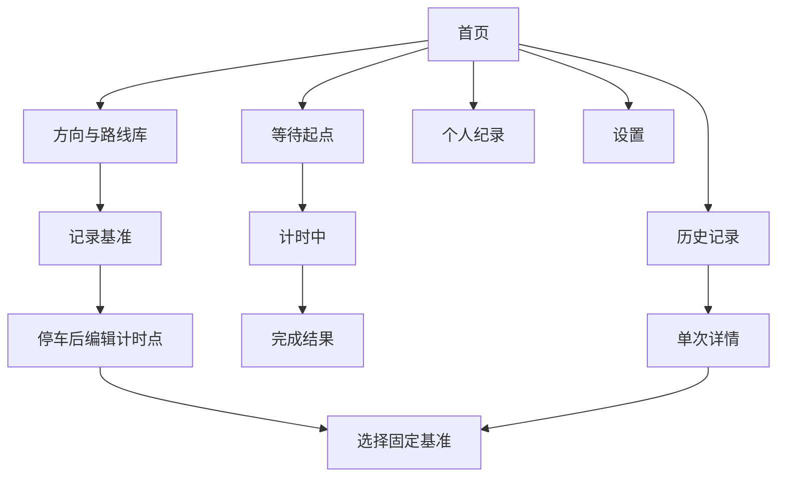

# 02 交互与视觉设计

## 1. 设计原则

1. **驾驶安全优先**：行驶中不出现必须处理的弹窗，不要求标点。
2. **计时信息优先**：当前 Sector、总时间和差值优先于图形装饰。
3. **单程语义明确**：所有路线图都必须有分离的 A、B 两端和方向箭头，禁止闭合赛道。
4. **真实地图只用于停车后的设置与复盘**。
5. **抽象路线用于驾驶**：黑底、细白线、低干扰、固定视图。
6. **颜色不单独承载信息**：颜色旁必须有“纪录/快于基准/慢于基准”等文字或符号。

## 2. 信息架构



## 3. 页面清单与验收要点

### 3.1 首页

- 显示上班/下班方向卡片、基准时间、PB、最近一次。
- 路线缩略图必须是开放 A→B。
- 主按钮“进入准备”，不是“立即开始计时”。
- 若没有方向，主按钮改为“录制第一条基准”。

### 3.2 路线库

- 每张卡显示方向、四点状态、基准日期、最近使用。
- 支持新建更多方向，但第一版首页只突出上班/下班。
- 删除采用二级页面确认，不在卡片上提供易误触的直接删除。

### 3.3 基准记录

- 出发前页面显示 GNSS 精度、服务状态和“开始记录”。
- 开始后进入极简状态；允许立即锁屏。
- 到达后用户手动结束，不在驾驶中设置 S1/S2。
- 记录全过程，不以经过预设点为前提。

### 3.4 停车后编辑计时点

- 使用高德地图展示录制轨迹；地图页不是日常驾驶页。
- 先裁剪轨迹起止，再按 A、S1、S2、B 的向导逐个选择。
- 点击轨迹时吸附到最近采样点；允许沿轨迹拖动。
- 每个点显示触发半径、局部方向、与前后点距离。
- 保存前检查：顺序、重复点、相邻点过近、A/B 未分离。
- 同时提供无地图降级编辑器：抽象轨迹＋里程百分比＋时间轴。

### 3.5 选择基准

- 默认推荐首次完整行程。
- 列表显示总时间和三个分段，不把 PB 自动等同于基准。
- 明确说明“切换基准不会删除或修改历史纪录”。

### 3.6 等待起跑

- 大字“GPS 已就绪 / 正在提高精度 / 定位不可用”。
- 显示 A 点和当前距离，不显示实时车速。
- 达标后显示“等待驶过起点 A”。
- 只允许取消准备；取消需要确认。

### 3.7 计时主界面

竖屏按 56%/44% 分层：

```
┌──────────────────────┐
│  计时中              S2 │
│      18:42.6           │
│      -00:12.4          │
│ S1  08:31.2  紫色 纪录  │
│ S2  当前               │
│ S3  --                 │
├──────────────────────┤
│ A ───╮                 │
│      ╰── S1 ─╮         │
│              ╰─●── S2  │
│                   ╰── B │
└──────────────────────┘
```

- 上层：总时间、相对基准累计差、Sector 行。
- 下层：基准抽象轨迹用暗灰/白细线，本次轨迹用更亮线逐步绘制。
- 路线分叉是正常现象，不提示“偏航”。
- 通过节点时短暂显示结果颜色，不使用夸张动画或声音。
- 行驶页不提供设置、历史和基准切换。
- 暂停不作为普通功能；只提供“结束本次”，避免暂停造成计时语义混乱。

### 3.8 锁屏通知

- 标题：上班计时中 · S2。
- 内容：18:42.6 · 比基准快 12.4 秒 · GNSS 良好。
- 可选进度：A、S1 已完成，等待 S2。
- 停止动作需长按/确认；不放“暂停”。
- 解锁回 App 后恢复相同状态，不重新启动服务。

### 3.9 完成结果

- 总时间与总差值。
- 三个 Sector 的时间、基准差和颜色原因。
- 结果可信度：良好/一般/低，支持展开查看。
- 若刷新 PB 或 Sector Best，分别说明，不能只显示“新纪录”。
- 操作：保存（默认自动保存）、查看详情、设为基准。

### 3.10 历史、详情、纪录

- 历史支持方向、有效性、日期筛选。
- 详情叠加基准与实际轨迹；不同路线不视为异常。
- 纪录页区分总 PB 与三个 Sector Best。
- 理论最佳明确标注“由不同出行的最快分段组合”。

### 3.11 设置

- 定位权限与系统定位状态。
- 锁屏继续计时状态与电池策略指引。
- 计时点半径、声音/振动、时间显示精度。
- 数据导出、删除全部数据。
- 高德地图隐私同意与 SDK 状态（如接入）。
- 安全提示：“请在停车后操作和查看详情”。

## 4. 抽象路线生成规范

- 输入使用当前要展示的轨迹，不做道路吸附后再用于计时。
- 将经纬度投影到局部平面坐标。
- 使用 Douglas–Peucker 简化，仅用于显示；原始点永不覆盖。
- 保留 A、S1、S2、B 附近关键点，避免简化后节点脱离线段。
- 按屏幕留白缩放，保留方向，不强制北朝上；可旋转使 A→B 视觉更舒展。
- 视图锁定后不因每个新点剧烈缩放；超出边界时平滑扩展。
- 基准路线暗灰 1～2 dp，本次轨迹白色 2～3 dp，完成分段再用结果色。

## 5. 可访问性与驾驶安全

- 正文至少满足常规 Android 可读尺寸，计时数字使用大号等宽字体。
- 紫/绿/黄同时配文字或图标，照顾色觉差异。
- 所有触控目标满足舒适尺寸，但驾驶中仍不依赖触控。
- 不使用持续闪烁、快速跳动背景、密集粒子或方格旗。
- 语音/提示音默认克制，可完全关闭。

## 6. 概念稿使用说明

概念图用于确定视觉语言和页面覆盖，不代表像素级最终稿。实现时必须以本文件的单程、可变路径、停车后标点和颜色语义为准；任何概念图中残留的环形赛道、暂停按钮或错误文字均不得直接照搬。

