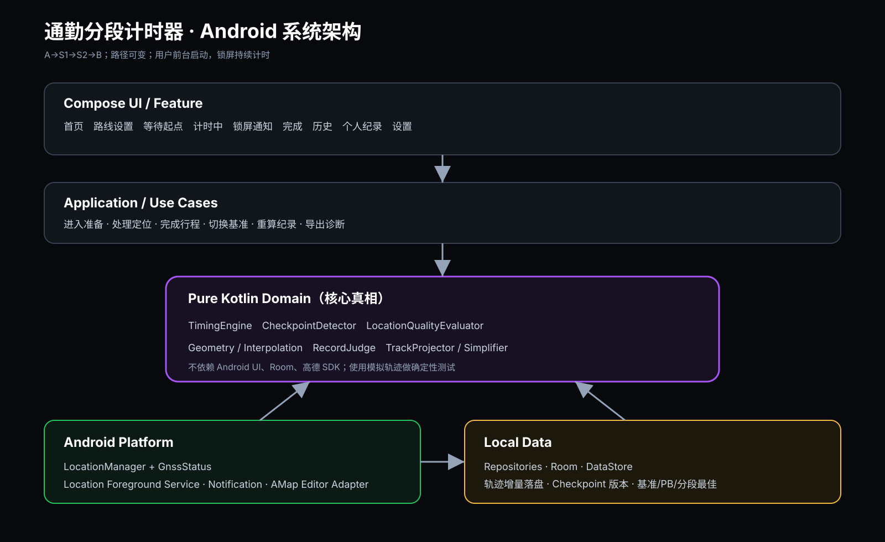
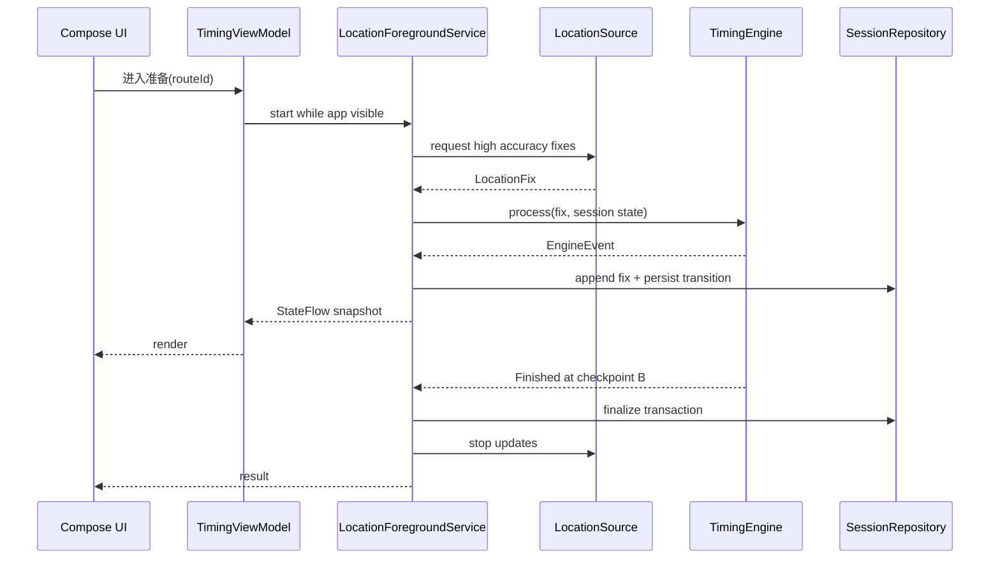

# 03 系统架构与模块

## 1. 总体方案

采用 Kotlin、Jetpack Compose、单 Activity、分层架构。计时核心不依赖 Compose、Room、高德或 Android Service，以便通过模拟 GNSS 点做确定性测试。



## 2. 逻辑分层

### UI 层

- Compose Screens：页面。
- ViewModel：页面状态与用户意图。
- Navigation：页面路由。
- Design System：色彩、字体、卡片、计时数字、路线 Canvas。

UI 不直接订阅 LocationManager，不直接写数据库，不持有计时状态机真相。

### Application / Use Case 层

- CreateRouteProfile
- StartBaselineRecording
- FinalizeBaselineRecording
- ArmCommuteSession
- ProcessLocationFix
- FinishSession
- SelectReferenceRun
- RecalculateRecords
- ExportDiagnostics

每个用例只编排领域对象和仓库接口。

### Domain 层

- TimingEngine：有序状态机。
- CheckpointDetector：计时点候选、穿线、最近点和确认。
- LocationQualityEvaluator：位置质量和时间不确定度。
- TrackProjector / TrackSimplifier：抽象路线。
- RecordJudge：PB、Sector Best、基准差与颜色。
- Geometry：距离、局部投影、线段交点、插值。

这是项目风险最高、测试优先级最高的一层。

### Data 层

- Room 数据库。
- Repository 实现。
- 增量轨迹写入和事务。
- Preferences/DataStore：非核心设置。
- Export：JSON/CSV/诊断包。

### Platform 层

- Android LocationManager/GNSS。
- GnssStatus 监控 GPS、北斗等星座状态。
- Location Foreground Service。
- Notification。
- 电池/定位/权限状态。
- AMap Map Adapter：仅设置与复盘真实地图，可替换、可禁用。

## 3. 推荐 Gradle 模块

```
:app
:core:model
:core:domain
:core:geometry
:core:database
:core:location
:core:designsystem
:feature:home
:feature:route-setup
:feature:timing
:feature:history
:feature:settings
```

第一轮若希望降低工程复杂度，可以先使用单 app module，但包结构必须遵循以上边界；算法稳定后再拆模块。

## 4. 核心运行数据流



## 5. 状态机

正式状态：

- IDLE：无进行中任务。
- BASELINE_RECORDING：完整录制轨迹，不触发 Sector。
- ARMED：已选方向，等待 A。
- START_CANDIDATE：正在确认 A。
- SECTOR_1：A 已确认，等待 S1。
- SECTOR_2：S1 已确认，等待 S2。
- SECTOR_3：S2 已确认，等待 B。
- FINISH_CANDIDATE：正在确认 B。
- COMPLETED：四点完成。
- CANCELLED：用户主动结束。
- INTERRUPTED：进程/系统/设备重启导致中断。
- INCOMPLETE：顺序缺失或定位质量无法判定。

状态转换必须作为事件落盘，不能只保存在 ViewModel 内存。

## 6. 前台服务边界

- 服务只允许在 App 前台、用户点击“开始记录/进入准备”后启动。
- 第一版不申请为了自动唤醒而设计的后台定位流程。
- 服务拥有当前 Session 的运行权威；Activity 重建后从服务/数据库恢复。
- 服务通过 StateFlow/Binder 或进程内仓库向 UI 暴露只读快照。
- 每个位置点先进入内存小批次，再在短间隔或关键事件时事务落盘。
- A、S1、S2、B 确认、锁屏、停止、异常均立即落盘。

## 7. 地图隔离

定义 `MapEditorAdapter`：

- showRecordedTrack
- selectPointOnTrack
- showCheckpointRadius
- convertWgs84ForDisplay
- snapshot

Domain 永远存 WGS84 原始 GNSS 坐标。高德所需坐标转换只发生在显示适配器中，禁止把 GCJ-02 显示坐标覆盖原始计时数据。

## 8. 依赖方向

```
feature/UI → use cases → domain ← repository interfaces
platform/location → domain models
data/room → repository interfaces
amap adapter → map editor interface
```

Domain 不依赖 Android framework、高德 SDK、Room Entity 或 Compose 类型。

## 9. 故障恢复

- 数据库保存 activeSessionId 和最后状态。
- App 启动时若发现未完成 session：
  - 服务仍活着：重新绑定并继续。
  - 服务已死但设备未重启：标记 INTERRUPTED，可查看已记录轨迹。
  - 已重启：必须标记 INTERRUPTED，因为单调时间基准已改变。
- 不自动把墙上时间差当作计时结果。

