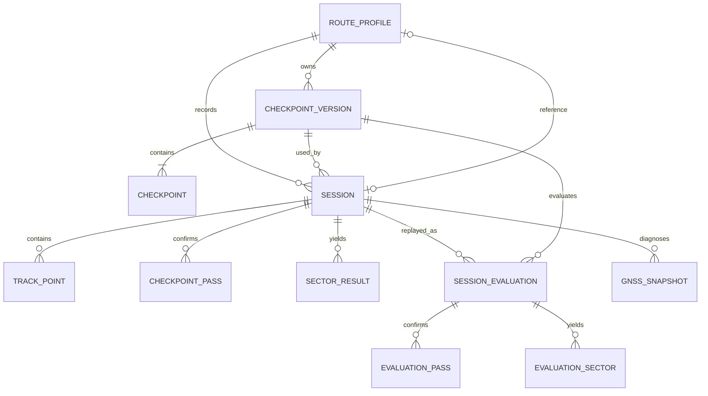

# 05 数据模型与存储

## 1. 数据原则

- Room 保存结构化信息，轨迹点可先同库分表；数据量验证后再决定二进制压缩。
- 所有时间字段写明单位和时钟来源。
- 坐标主数据统一 WGS84。
- 计时点采用版本化快照，保证历史可重放。
- 基准是显式外键，不通过“当前最快”临时推导。

## 2. 实体

### RouteProfileEntity

| 字段 | 类型 | 说明 |
|---|---|---|
| id | UUID/String | 主键 |
| name | String | 上班、下班等 |
| directionType | Enum | TO_WORK/FROM_WORK/CUSTOM |
| activeCheckpointVersionId | FK | 当前计时点版本 |
| referenceSessionId | FK nullable | 固定基准 |
| createdAt/updatedAt | Instant | 墙上时间 |
| archived | Boolean | 归档 |

### CheckpointVersionEntity

- id、routeProfileId、versionNumber
- createdFromSessionId
- createdAt
- active
- changeReason

### CheckpointEntity

- id、checkpointVersionId
- orderIndex：0..3
- label：A/S1/S2/B
- latitude、longitude
- radiusMeters
- preferredBearing、bearingTolerance
- gateHalfWidthMeters
- sourceTrackPointId（可空）

### SessionEntity

- id、routeProfileId、checkpointVersionId
- mode：BASELINE_RECORDING / TIMED
- status：RECORDING/ARMED/COMPLETED/CANCELLED/INTERRUPTED/INCOMPLETE
- referenceSessionIdSnapshot
- startedWallTime、endedWallTime
- monotonicBootId（App 生成的设备启动会话标识）
- startElapsedNanos、finishElapsedNanos
- totalDurationNanos
- validity、qualityGrade、invalidReason
- appVersion、deviceModel、androidVersion
- isMockDetected
- createdAt

### TrackPointEntity

- id（Long 自增）
- sessionId、sequence
- latitude、longitude
- elapsedRealtimeNanos、wallTimeMillis
- accuracyMeters
- speedMps、speedAccuracy
- bearingDegrees、bearingAccuracy
- altitude（可空）
- provider、isMock
- usedForTiming

索引：`(sessionId, sequence)` 唯一，`(sessionId, elapsedRealtimeNanos)`。

### CheckpointPassEntity

- id、sessionId、checkpointId
- orderIndex
- passElapsedNanos
- interpolatedLatitude/Longitude
- triggerMode：LINE_CROSSING/CLOSEST_APPROACH/MANUAL_REVIEW
- closestDistanceMeters
- estimatedUncertaintyMillis
- confidence
- rawPointBeforeId/rawPointAfterId

### SectorResultEntity

- sessionId、sectorIndex
- startPassId、endPassId
- durationNanos
- referenceDurationNanos
- previousBestDurationNanos
- deltaToReferenceNanos
- resultColorAtCompletion
- recordQualified

### SessionEvaluationEntity（v4）

- `sessionId + checkpointVersionId` 唯一，表示同一条原始轨迹在某版计时点下的成绩。
- 保存重算状态、失败原因、A/B 单调时刻、总时长、质量、月/周参考、双 Δ、颜色及计时算法版本。
- `EvaluationPassEntity` 和 `EvaluationSectorEntity` 分别保存该评估的四个通过点与三个分段。
- 原 `CheckpointPassEntity`、`SectorResultEntity` 作为原始版本兼容数据保留，不再因移动计时点而删除。

### CheckpointRecalculationJobEntity（v4）

- 保存待重算计时点版本、源轨迹、总数、完成数、成功/失败数、任务状态和错误。
- 新计时点在任务完成前保持未激活；任务完成后在事务中切换活动版本。
- `PENDING/RUNNING` 任务在 App 再次启动后自动续跑，`FAILED` 任务允许人工重试。

### GnssSnapshotEntity（低频/诊断）

- sessionId、elapsedRealtimeNanos
- visibleGps/usedGps
- visibleBeidou/usedBeidou
- visibleGalileo/usedGalileo
- visibleOther/usedOther

### AppSetting

使用 DataStore：主题、提示音、默认半径、时间显示精度、诊断模式、地图隐私同意版本。核心计时状态不放 DataStore。

## 3. 关系图

## 4. 事务

关键事务：

1. 创建 session＋设 activeSession。
2. append track point batch。
3. 确认 checkpoint pass＋更新状态＋生成已完成 sector。
4. 完成 session＋计算质量＋判定纪录＋清除 activeSession。
5. 切换基准，只更新 RouteProfile.referenceSessionId，不重写旧 SectorResult。
6. 编辑计时点，创建未激活的新 CheckpointVersion，回放全部历史轨迹并写入版本化评估；完成后原子激活，不覆盖旧版本。

## 5. 保留与隐私

- 默认全部本地保存。
- 删除一个 session 时级联删除轨迹、通过点、分段和 GNSS 快照。

## 0.2.0 数据升级

- Room schema 升级到版本 2，显式保留版本 1 的全部数据。
- `TrackPoint` 增加可空的速度精度，用于排除不可信峰值。
- `Session` 增加最高速度、峰值单调时间和峰值墙上时间。
- 当前纪录、周/月统计和基准候选必须匹配 RouteProfile 的 activeCheckpointVersionId；旧版本只进入历史。
- 删除 RouteProfile 前提示其历史数量；可优先归档。
- 导出包默认不包含精确地址文字，但包含坐标时必须明确提醒属于敏感位置数据。
- 日志不得直接打印完整家庭/公司经纬度；诊断日志可做相对坐标或截断。

## 6. 迁移

- 数据库从 v1 即启用 migration test。
- Schema 导出纳入版本控制。
- 枚举在数据库中存稳定字符串/整数映射，不依赖 Kotlin ordinal。
- 每个版本提供 migration 和降级不支持提示，禁止 destructive migration 删除用户历史。

## 0.3.0 数据升级

- Room schema 升级到版本 4；v3 的每条计时成绩、通过点与分段复制为其原始计时点版本的评估。
- 原始 `Session`、`TrackPoint`、`CheckpointPass` 和 `SectorResult` 不删除、不改写。
- 当前纪录、月/周统计、实时参考和历史默认成绩统一读取活动计时点版本的有效评估。
- JSON 诊断导出升级为 v2 并包含全部评估版本；CSV 导出当前版本成绩与评估状态。
